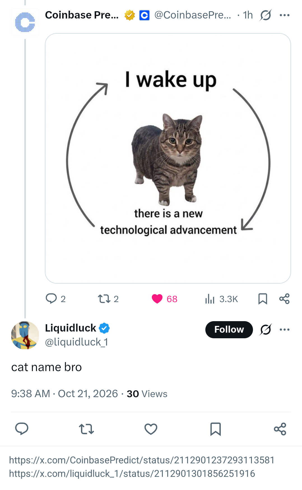

<p align="center"></p>

<h1 align="center">TweetPick</h1>

**Pick tweets as images from any Android app.** TweetPick opens x.com in an in-app browser. You select tweets from your bookmarks, your likes or your own tweets and replies. TweetPick saves them as one image that looks like a native screenshot, with each tweet's link below it. Other apps can use it as an image picker, so you can attach a tweet straight to an imageboard post, a chat or a forum.

<p align="center">
  
</p>

## Download

**[⬇ Download the latest APK](https://github.com/fluorine/tweetpick/releases/latest/download/tweetpick.apk)**. You can also browse all [releases](https://github.com/fluorine/tweetpick/releases).

To install:

1. Open the APK on your phone.
2. Allow "Install unknown apps" for your browser or file manager when Android asks.
3. Android 8.0 (API 26) or newer is necessary.

The alpha builds are debug-signed. Play Protect can show a warning.

## How to use

1. Open TweetPick and sign in on X's own login page. Use your username and password. Google sign-in does not work inside an in-app browser.
2. Go to **Bookmarks**, **Likes** or **Mine** (your tweets and replies). You can also use **Search** for your tweets, all of X, or text on the current page.
3. Tap the red **+** at the lower right of a tweet. It changes to **✓**. Select more tweets to capture a thread.
4. Tap **Capture**. TweetPick scrolls through the selection and joins the parts into one image.
5. In the preview, tap **Share** or **Keep**. If another app opened TweetPick, tap **Use** to send the image to that app.

## Features

- **Image picker.** TweetPick answers `GET_CONTENT` and `PICK` requests for `image/*`. It also shows as "TweetPick" in the system file picker, with all saved captures.
- **Native look.** The image is X's own rendering, not a copy of it. Sticky bars and TweetPick's buttons are hidden during capture.
- **Long tweets and threads.** Capture scrolls down and stitches. The limit is 8000 px of height.
- **Link footer.** A reply chain gets one link, the one for its last selected reply. Unrelated tweets each get their own link.
- **Size limit.** The file is PNG. If the PNG is larger than about 4 MB, TweetPick uses JPEG so the file stays below common upload limits.
- **Theme.** Select **⋯ → Theme**: System, Light or Dark. Set X's own display setting to "Use device settings" so that X follows it.

## Build

You need JDK 17 and Android SDK 35. Set `sdk.dir` in `local.properties`.

```bash
./gradlew assembleDebug
```

The APK is in `app/build/outputs/apk/debug/app-debug.apk`.

### Emulator

```bash
emulator -avd tweetpick -dns-server 8.8.8.8,1.1.1.1
adb install -r app/build/outputs/apk/debug/app-debug.apk
```

On Windows, `start-emulator.cmd` starts the `tweetpick` AVD without a console window. Use `-dns-server` when the emulator cannot resolve hosts through your network's DNS.

## Known limits

- X has no text search for likes. Use **Search → On this page** after you scroll.
- Bookmark search on X requires Premium.
- Capture depends on X's page markup (`data-testid`). If X changes it, capture can stop working.
- All selected tweets must be loaded on the page when you tap Capture.

## Disclaimer

TweetPick is not affiliated with X Corp. It shows x.com in a WebView and copies what is on your screen. It does not use the X API, and it does not scrape in bulk.
